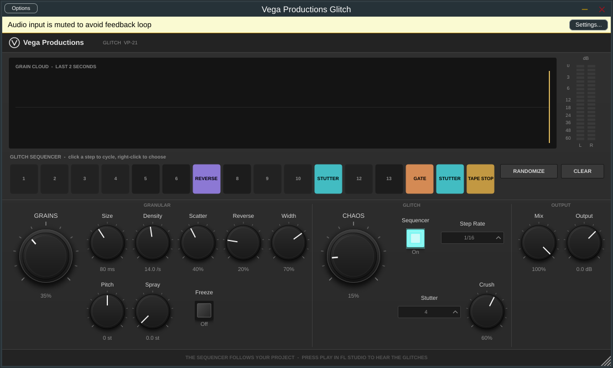

# Vega Productions Glitch (VP-21)

Granular textures and a tempo-synced glitch sequencer: robotic percussion, stutters, reverse swells and broken-tape moments.



## Download
- **Windows (FL Studio):** https://github.com/DJVega70/vega-glitch/releases/latest/download/VegaProductions-Glitch-Windows-VST3.zip
- **macOS:** https://github.com/DJVega70/vega-glitch/releases/latest/download/VegaProductions-Glitch-macOS-VST3-AU.zip

## Granular
A cloud of up to 48 grains taken from the last 2 seconds of audio: **Size** (10–500 ms), **Density**, **Scatter** (how far back grains reach), **Pitch** (±24 st), **Pitch Spray** (random detune), **Reverse** probability, **Width**, and **Freeze** to hold the buffer and play it as an endless texture.

## Glitch sequencer
16 steps at 1/32, 1/16, 1/8 or 1/4, locked to the project. Each step can be **Stutter** (2–16 repeats), **Reverse**, **Tape Stop**, **Crush**, **Pitch Up / Down** (an octave) or **Gate**. **RANDOMIZE** writes a new pattern; **CHAOS** randomly swaps effects and repeat counts as it plays, so no two bars are the same. Click a step to cycle, right-click to choose.

Mix and Output. Empty pattern + no grains passes audio untouched.

## Building
```
cmake -B build -DVEGA_TESTS=ON
cmake --build build --config Release --target VegaGlitch_VST3 VegaGlitchTest
```
